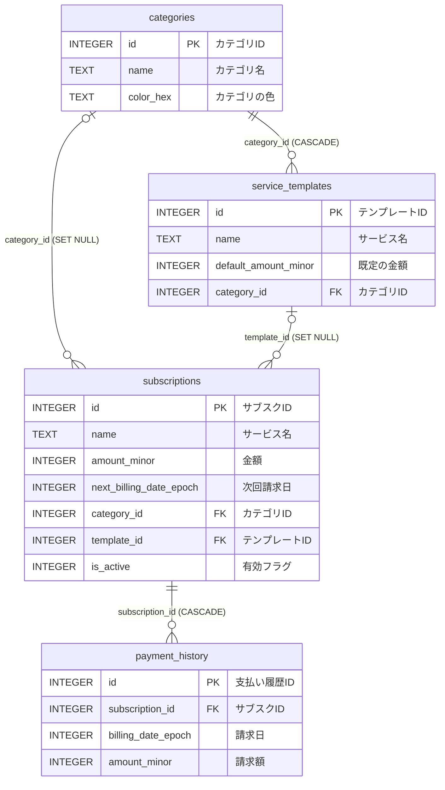
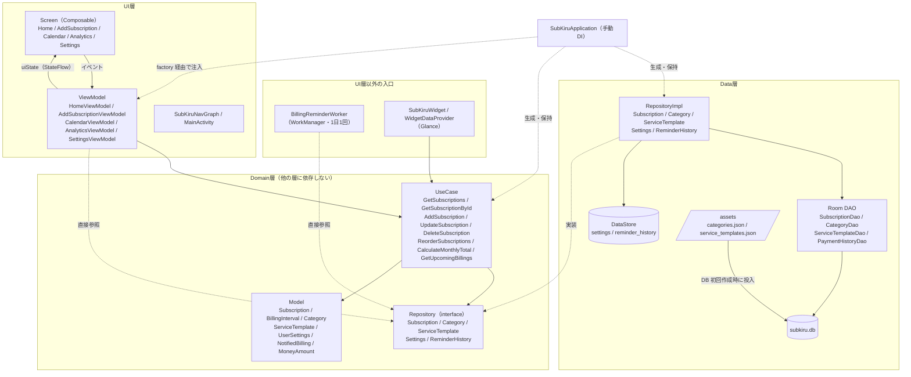
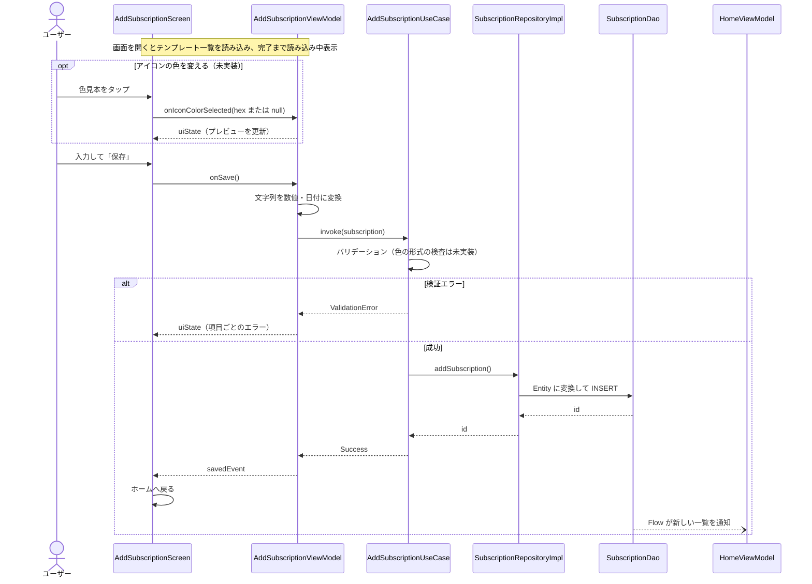
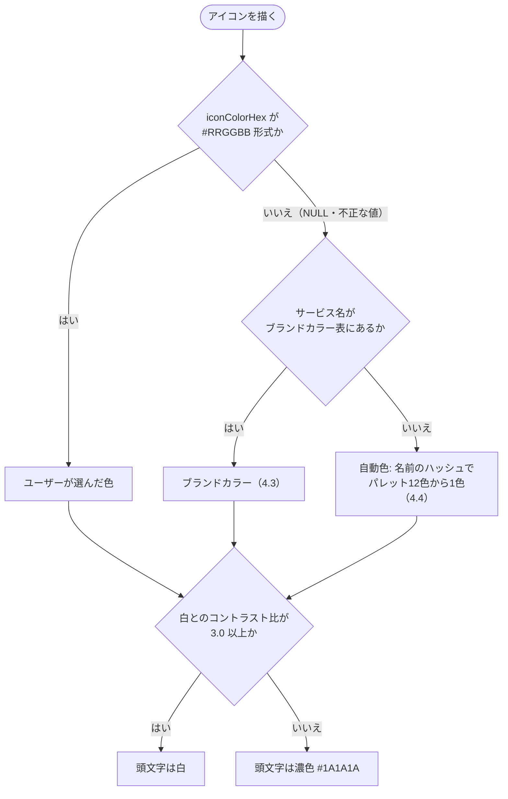

# SubKiru 設計図（DESIGN.md）

最終更新: 2026-10-11 / 対象: DB スキーマ version 3（version 4 は実装予定）

データモデル・画面遷移・層構成・アイコンの色の決め方を図で示します。記載内容は現在の実装に基づきます。

> **未実装の範囲（実装予定）**: 次の内容は設計のみで、まだ実装していません。該当箇所には「未実装」と付けています。実装が終わったら、この注記と各箇所の「未実装」を外します。
>
> - `subscriptions.icon_color_hex` と DB スキーマ version 4（[1.1](#11-roomsubkirudb)）
> - `Subscription.iconColorHex`（[1.3](#13-ドメインモデルとの対応)）
> - 追加フローでの色の選択と形式の検証（[3.3](#33-データの流れサブスク追加の例)）
> - [4章](#4-アイコンの色) の全体。現在の実装は、カテゴリの色を薄めた背景、または名前から決まる淡色8色に、濃色の頭文字を表示する
機能の仕様は [SPEC.md](SPEC.md)、開発ルールは [AGENTS.md](AGENTS.md) を参照してください。

---

## 1. データモデル

### 1.1 Room（`subkiru.db`）

**テーブル一覧**

| 物理名 | 論理名 | 役割 | 利用状況 |
|--------|--------|------|----------|
| `subscriptions` | サブスクリプション | ユーザーが登録した契約。1行が1契約 | 使用中 |
| `categories` | カテゴリ | サブスクの分類（動画配信、音楽など） | 使用中（初期データ7件を参照するのみ。追加・編集の画面はない） |
| `service_templates` | サービステンプレート | 人気サービスのプリセット。追加画面の入力補助に使う | 使用中（初期データ22件を参照するのみ） |
| `payment_history` | 支払い履歴 | 請求ごとの支払い記録 | 未使用（定義のみで、読み書きする処理がない） |

**ER 図**

テーブル間の関係を示します。列は主キー・外部キーと主なものだけを載せ、注記は論理名です。全列の定義は図の下の「テーブル定義」を参照してください。

関係線のラベルは「外部キー（親を削除したときの子の挙動）」です。

**テーブル定義**

表の見方は次のとおりです。

- **型**: SQLite の型です。真偽値は `INTEGER`（1 = true、0 = false）で持ちます。
- **NULL**: 「可」は NULL を保存できる列、「不可」は必ず値が入る列です。
- **既定値**: DB の列に設定した既定値です。「—」は既定値なしで、保存時に必ず値を指定します。
- **日付と日時の単位**: 「epochDay」は 1970-01-01 からの日数（`LocalDate.toEpochDay()`）で、時刻を持たない日付に使います。「UnixMs」は 1970-01-01 00:00 UTC からのミリ秒で、時刻が必要な日時に使います。
- **金額の単位**: 最小通貨単位の整数です（JPY は円、USD はセント。980円 → `980`、9.99ドル → `999`）。

#### `subscriptions`（サブスクリプション）

ユーザーが登録した契約です。削除は `is_active` を 0 にする論理削除で、行は残ります。

| 物理名 | 論理名 | 型 | NULL | 既定値 | キー | 説明 |
|--------|--------|----|------|--------|------|------|
| `id` | サブスクID | INTEGER | 不可 | 自動採番 | PK | 行を一意に識別する番号 |
| `name` | サービス名 | TEXT | 不可 | — | | 画面に表示する名前。アイコンの頭文字とブランドカラーの判定にも使う |
| `amount_minor` | 金額 | INTEGER | 不可 | — | | 1回の請求額（最小通貨単位）。月額換算前の値 |
| `currency_code` | 通貨コード | TEXT | 不可 | `JPY` | | ISO 4217 の通貨コード。現在登録できるのは JPY のみ |
| `billing_interval_unit` | 請求間隔の単位 | TEXT | 不可 | `MONTHLY` | | `DAILY` / `WEEKLY` / `MONTHLY` / `YEARLY` のいずれか |
| `billing_interval_count` | 請求間隔の回数 | INTEGER | 不可 | `1` | | 単位と組み合わせて間隔を表す。例: 3か月ごと = `MONTHLY` × 3 |
| `start_date_epoch` | 開始日 | INTEGER | 不可 | — | | 契約を始めた日（epochDay）。カレンダーではこの日より前に請求を表示しない |
| `next_billing_date_epoch` | 次回請求日 | INTEGER | 不可 | — | IDX | 次に請求される日（epochDay）。保存時に「開始日 + 請求間隔1回分」で決まり、時間が経っても進まない |
| `category_id` | カテゴリID | INTEGER | 可 | — | FK, IDX | `categories.id` を指す。NULL はカテゴリ未選択 |
| `template_id` | テンプレートID | INTEGER | 可 | — | FK, IDX | `service_templates.id` を指す。テンプレートから登録した場合のみ入る。サービス名を書き換えると NULL になる |
| `logo_uri` | ロゴの URI | TEXT | 可 | — | | 未使用（常に NULL）。旧ロゴ取得方式の名残 |
| `memo` | メモ | TEXT | 可 | — | | ユーザーの自由記入。空白のみの入力は NULL として保存する |
| `is_active` | 有効フラグ | INTEGER | 不可 | `1` | IDX | 1 = 有効、0 = 削除済み。0 の行はすべての画面・通知・ウィジェットから除外する |
| `created_at` | 作成日時 | INTEGER | 不可 | — | | 登録した日時（UnixMs）。ホームの「新しい順」に使う。編集しても変わらない |
| `updated_at` | 更新日時 | INTEGER | 不可 | — | | 最後に保存した日時（UnixMs） |
| `sort_order` | 並び順 | INTEGER | 不可 | `0` | | ホームの「カスタム」での表示順（小さいほど上）。新規登録は末尾の番号を割り当てる。version 3 で追加 |
| `icon_color_hex` | アイコンの色 | TEXT | 可 | — | | ユーザーが選んだアイコンの背景色（`#RRGGBB`、英字は大文字）。NULL は自動（[4章](#4-アイコンの色)）。version 4 で追加。**未実装** |

#### `categories`（カテゴリ）

サブスクの分類です。DB 初回作成時に `assets/categories.json` から7件を投入します。

| 物理名 | 論理名 | 型 | NULL | 既定値 | キー | 説明 |
|--------|--------|----|------|--------|------|------|
| `id` | カテゴリID | INTEGER | 不可 | 自動採番 | PK | 行を一意に識別する番号 |
| `name` | カテゴリ名 | TEXT | 不可 | — | | 画面に表示する名前（例: 動画配信） |
| `icon_name` | アイコン名 | TEXT | 不可 | — | | カテゴリのアイコンを表す名前（例: `video`）。現在は画面で使っていない |
| `color_hex` | カテゴリの色 | TEXT | 不可 | — | | `#RRGGBB` 形式の色。追加・編集画面のカテゴリ選択で、名前の横のドットに使う |
| `sort_order` | 並び順 | INTEGER | 不可 | — | | カテゴリ選択での表示順（小さいほど上。同じ値なら名前順） |

#### `service_templates`（サービステンプレート）

人気サービスのプリセットです。DB 初回作成時に `assets/service_templates.json` から22件を投入します。追加画面で選ぶと、名前・金額・請求間隔・カテゴリを入力欄に写します。

| 物理名 | 論理名 | 型 | NULL | 既定値 | キー | 説明 |
|--------|--------|----|------|--------|------|------|
| `id` | テンプレートID | INTEGER | 不可 | 自動採番 | PK | 行を一意に識別する番号 |
| `name` | サービス名 | TEXT | 不可 | — | | サービスの表示名（例: Netflix）。一覧はこの名前の昇順で並べる |
| `default_amount_minor` | 既定の金額 | INTEGER | 不可 | — | | 入力欄に写す金額（最小通貨単位） |
| `default_currency_code` | 既定の通貨コード | TEXT | 不可 | `JPY` | | ISO 4217 の通貨コード。初期データはすべて JPY |
| `default_interval_unit` | 既定の請求間隔の単位 | TEXT | 不可 | `MONTHLY` | | `DAILY` / `WEEKLY` / `MONTHLY` / `YEARLY` のいずれか。初期データはすべて `MONTHLY` |
| `default_interval_count` | 既定の請求間隔の回数 | INTEGER | 不可 | `1` | | 単位と組み合わせて間隔を表す |
| `logo_resource_name` | ロゴのリソース名 | TEXT | 不可 | — | | 未使用（全件 `ic_service_default`）。旧ロゴ表示方式の名残 |
| `category_id` | カテゴリID | INTEGER | 不可 | — | FK, IDX | `categories.id` を指す。選んだときに入力欄へ写すカテゴリ |
| `search_keywords` | 検索キーワード | TEXT | 不可 | — | | カンマ区切りの検索語。検索の画面がないため、現在は使っていない |
| `domain` | ドメイン | TEXT | 不可 | 空文字 | | サービスのドメイン（例: `netflix.com`）。未使用。旧ロゴ取得方式の名残。version 2 で追加 |

#### `payment_history`（支払い履歴）

請求ごとの支払い記録を残すためのテーブルです。定義のみで、読み書きする処理はありません。

| 物理名 | 論理名 | 型 | NULL | 既定値 | キー | 説明 |
|--------|--------|----|------|--------|------|------|
| `id` | 支払い履歴ID | INTEGER | 不可 | 自動採番 | PK | 行を一意に識別する番号 |
| `subscription_id` | サブスクID | INTEGER | 不可 | — | FK, IDX | `subscriptions.id` を指す |
| `billing_date_epoch` | 請求日 | INTEGER | 不可 | — | IDX | 請求された日（epochDay） |
| `amount_minor` | 請求額 | INTEGER | 不可 | — | | 実際に請求された金額（最小通貨単位） |
| `currency_code` | 通貨コード | TEXT | 不可 | — | | ISO 4217 の通貨コード |
| `is_paid` | 支払い済みフラグ | INTEGER | 不可 | — | | 1 = 支払い済み、0 = 未払い |
| `recorded_at` | 記録日時 | INTEGER | 不可 | — | | この行を記録した日時（UnixMs） |

**外部キー**

| 子の列 | 親 | 親の行を削除したとき | 意図 |
|--------|----|----------------------|------|
| `subscriptions.category_id` | `categories.id` | 子の列を NULL にする（SET NULL） | カテゴリがなくなっても、サブスクは「未選択」として残す |
| `subscriptions.template_id` | `service_templates.id` | 子の列を NULL にする（SET NULL） | テンプレートがなくなっても、サブスクは残す |
| `service_templates.category_id` | `categories.id` | 子の行も削除する（CASCADE） | カテゴリのないテンプレートは残さない |
| `payment_history.subscription_id` | `subscriptions.id` | 子の行も削除する（CASCADE） | サブスクを物理削除したら、履歴も残さない |

サブスクの削除は論理削除（`is_active` = 0）なので、通常の操作で `payment_history` の CASCADE が働くことはありません。

**インデックス**

| インデックス名 | 対象の列 | 目的 |
|----------------|----------|------|
| `index_subscriptions_next_billing_date_epoch` | `subscriptions.next_billing_date_epoch` | 次回請求日での並べ替え・絞り込み |
| `index_subscriptions_is_active` | `subscriptions.is_active` | 有効なサブスクだけの取得 |
| `index_subscriptions_category_id` | `subscriptions.category_id` | 外部キーの照合 |
| `index_subscriptions_template_id` | `subscriptions.template_id` | 外部キーの照合 |
| `index_service_templates_category_id` | `service_templates.category_id` | 外部キーの照合 |
| `index_payment_history_subscription_id` | `payment_history.subscription_id` | 外部キーの照合 |
| `index_payment_history_billing_date_epoch` | `payment_history.billing_date_epoch` | 請求日での絞り込み |

すべて一意制約のない通常のインデックスです。

**マイグレーション履歴**

| version | 変更 |
|---------|------|
| 1 → 2 | `service_templates` に `domain` を追加 |
| 2 → 3 | `subscriptions` に `sort_order` を追加し、既存行に順序を割り当て |
| 3 → 4（未実装） | `subscriptions` に `icon_color_hex`（TEXT、NULL 可）を追加。既存行は NULL（自動）のまま |

### 1.2 DataStore（Preferences）

DB に入れるほどではない設定値と記録を、キーと値の組で保存します。

| ファイル | キー（物理名） | 論理名 | 型 | 既定値 | 説明 |
|----------|----------------|--------|----|--------|------|
| `settings` | `reminder_enabled` | リマインダー有効フラグ | Boolean | false | 請求日リマインダーの ON/OFF。設定画面のスイッチで変える |
| `settings` | `reminder_days_before` | 通知タイミング | Int | 1 | 請求日の何日前から通知するか（1〜7） |
| `reminder_history` | `notified_billings` | 通知済みの請求 | Set&lt;String&gt; | 空 | 通知を出した請求の一覧。1件は `{サブスクID}:{請求日のepochDay}` 形式（例: `7:20615`）。同じ請求を二度通知しないために使い、請求日を過ぎた記録は日次チェックで削除する |

### 1.3 ドメインモデルとの対応

Entity とドメインモデルの変換は各 `RepositoryImpl` 内で行います。主な変換は次のとおりです。

| Entity（Room） | ドメインモデル |
|----------------|----------------|
| `billing_interval_unit` + `billing_interval_count` | `BillingInterval` |
| `*_date_epoch`（Long, epochDay） | `LocalDate` |
| `created_at` / `updated_at`（Long, UnixMs） | `Instant` |

`Subscription.iconColorHex` は未実装です。追加するときは既定値を `null`（自動）にします（`sortOrder` と同じ扱い）。値の形式と決め方は [4章](#4-アイコンの色) を参照してください。

---

## 2. 画面遷移

| 画面 | ルート | ボトムナビ | ＋ボタン |
|------|--------|-----------|----------|
| ホーム | `home` | 表示 | 表示 |
| カレンダー | `calendar` | 表示 | 非表示 |
| 分析 | `analytics` | 表示 | 非表示 |
| 設定 | `settings` | 表示 | 非表示 |
| サブスク追加 | `add_subscription` | 非表示 | 非表示 |
| サブスク編集 | `edit_subscription/{subscriptionId}`（Long） | 非表示 | 非表示 |

- 起動時の画面はホームです。通知・ウィジェットからの起動もホームを表示します（特定の画面への直接遷移はありません）。
- 図ではタブ間の矢印を隣同士だけ描いていますが、4つのタブはどれからどれへも直接切り替えられます。タブ切り替えではバックスタックを積まず、各タブの状態を保持します。
- 追加と編集は同じ画面実装（`AddSubscriptionScreen` / `AddSubscriptionViewModel`）を共用します。編集ではテンプレート一覧を表示しません。

---

## 3. 層構成

依存の方向は **UI → Domain ← Data** です。`SubKiruApplication` が Repository と UseCase を生成・保持し、各 ViewModel の `factory` に渡します（手動 DI）。

### 3.1 各入口が使う UseCase / Repository

| 入口 | UseCase | Repository を直接参照 |
|------|---------|----------------------|
| `HomeViewModel` | GetSubscriptions / DeleteSubscription / ReorderSubscriptions | `CategoryRepository` |
| `AddSubscriptionViewModel`（追加・編集） | AddSubscription / UpdateSubscription / GetSubscriptionById | `CategoryRepository` / `ServiceTemplateRepository`（追加時のテンプレート一覧） |
| `CalendarViewModel` | GetSubscriptions | — |
| `AnalyticsViewModel` | GetSubscriptions | — |
| `SettingsViewModel` | — | `SettingsRepository` |
| `BillingReminderWorker` | — | `SettingsRepository` / `SubscriptionRepository` / `ReminderHistoryRepository` |
| `SubKiruWidget` | CalculateMonthlyTotal / GetUpcomingBillings | — |

### 3.2 原則からの逸脱

AGENTS.md は「ViewModel は UseCase のみを呼ぶ」と定めていますが、図の点線「直接参照」のとおり、次の箇所は Repository の interface を直接使っています。いずれも Domain 層の interface への依存であり、DAO や Room には触れていません。

- カテゴリ一覧の取得（`HomeViewModel` / `AddSubscriptionViewModel`）
- テンプレート一覧の取得（`AddSubscriptionViewModel`。追加時のみ）
- 設定の読み書き（`SettingsViewModel`）
- リマインダーの日次チェック（`BillingReminderWorker`）

### 3.3 データの流れ（サブスク追加の例）

Room を唯一の情報源とし、一覧系の画面は DAO の `Flow` を購読しています。書き込みが完了すると、ホーム・カレンダー・分析は自動的に再描画されます。

---

## 4. アイコンの色

> この章は未実装です（実装予定の設計）。

サービスのアイコンは、公式ロゴを使わず「背景色 + サービス名の頭文字」で描きます。描画は共通部品 `ServiceAvatar` が担い、色の決定は Android に依存しない純粋な関数（`core/ui/component/ServiceAvatarLogic.kt`）に置きます。

### 4.1 背景色の決め方

- 同じサブスクは、どの画面でも同じ色になります。カテゴリの色はアイコンに使いません。
- サービス名が空で、ユーザーが色を選んでいない場合は、従来どおり既定アイコン（`ic_service_default`）を表示します。色を選んでいる場合は、頭文字なしでその色だけを表示します。

### 4.2 頭文字の色と大きさ

| 項目 | 内容 |
|------|------|
| 文字色 | 背景色と白のコントラスト比が 3.0 以上なら白、未満なら濃色（`#1A1A1A`） |
| コントラスト比 | WCAG の相対輝度（sRGB をリニア化して 0.2126R + 0.7152G + 0.0722B）から求める |
| 太さ | Bold |
| 大きさ | アイコンの一辺に比例させる（初期値は一辺の 45%）。端末の文字サイズ設定では拡大しない |

- しきい値と比率は `const val` で名前を付けます。
- 「コントラストが高い方を選ぶ」方式は採りません。赤系のブランドカラーが境界付近に集まり、ほぼ同じ赤でも白文字と濃色文字に割れるためです。
- 3.0 は大きい文字向けの基準です。そのため頭文字を太字にし、小さいアイコン（カレンダーの請求マークは 18dp）でも欠けないよう、文字の大きさをアイコンに合わせます。

### 4.3 ブランドカラー表

プリセット22サービスの色を Kotlin の定数マップで持ちます。DB や `service_templates.json` には持たせません（DB 変更なしで、既存ユーザーにも次の更新で反映されるため）。

**照合のルール**

- サービス名が表の名前と完全に一致するものだけに色を付けます。
- 比べる前に、前後の空白を除き、大文字小文字と全角半角の違いをなくします（「 netflix 」「ＮＥＴＦＬＩＸ」は「Netflix」と一致）。
- 部分一致（「Netflix スタンダード」）と別表記（「ネットフリックス」）は一致としません。部分一致は「Amazon」のような短い名前で誤った色が付くためで、別表記は対応表が際限なく増えるためです。
- テンプレートから登録したかどうかは問いません（手入力の「netflix」にも色が付きます）。

**色の一覧**

| サービス | 色 | 頭文字 | 照合の結果（2026-10-10） |
|----------|----|--------|--------------------------|
| Netflix | `#E50914` | 白 | 二次情報と一致 |
| Amazon Prime | `#00A8E1` | 濃色 | 二次情報と一致（Prime Video は `#2D75FA` とする情報もある） |
| Disney+ | `#02D6E8` | 濃色 | 二次情報の値を採用（2024年からのロゴの色とされる。当初の案は `#113CCF`） |
| U-NEXT | `#000000` | 白 | 情報なし |
| Hulu | `#1CE783` | 濃色 | 二次情報と一致（米国 Hulu のガイドラインの値とされる。日本の Hulu は別会社で、未確認） |
| YouTube Premium | `#FF0000` | 白 | 二次情報と一致 |
| Spotify | `#1ED760` | 濃色 | 二次情報の値を採用（現行の色とされる。当初の案 `#1DB954` は以前の色） |
| Apple Music | `#FA243C` | 白 | 二次情報と一致 |
| Amazon Music Unlimited | `#0DBFF5` | 濃色 | 二次情報の値を採用（当初の案は `#25D1DA`） |
| LINE MUSIC | `#06C755` | 濃色 | **公式ページで確認**（LINE の色。LINE MUSIC 固有の色は未確認） |
| Google One | `#4285F4` | 白 | 二次情報と一致（Google の青。Google One 固有の色は未確認） |
| iCloud+ | `#3693F3` | 白 | 情報なし |
| Dropbox Plus | `#0061FE` | 白 | 二次情報の値を採用（当初の案は `#0061FF`） |
| PlayStation Plus | `#003791` | 白 | 二次情報と一致（PlayStation の青。PlayStation Plus は黄色 `#FCC71D` とする情報もある） |
| Nintendo Switch Online | `#E60012` | 白 | 二次情報と一致（任天堂は色の値を公開していないとされる） |
| Xbox Game Pass | `#107C10` | 白 | 二次情報と一致（Xbox のガイドラインの値とされる） |
| 日経電子版 | `#0A3E6F` | 白 | 情報なし |
| Kindle Unlimited | `#FF9900` | 濃色 | 未調査 |
| 楽天マガジン | `#BF0000` | 白 | 二次情報と一致（楽天のガイドラインの値とされる） |
| Microsoft 365 | `#D83B01` | 白 | 二次情報と不一致のまま維持（Microsoft のロゴの橙は `#F25022`。Microsoft 365 固有の単色は未確認） |
| Adobe Creative Cloud | `#EB1000` | 白 | 二次情報の値を採用（ほかにも複数の値がある。当初の案は `#FA0F00`） |
| 1Password | `#0572EC` | 白 | 二次情報と不一致のまま維持（`#198CFF` とする情報が1件あるが、根拠が弱い） |

- 「公式ページで確認」は、各社のページに書かれた値を直接読めたものです。LINE の開発者向けガイドラインだけが該当します。
- 「二次情報」は、ブランドカラーをまとめた第三者のサイトです。各社の公式ページ（Netflix、Spotify、YouTube、Dropbox、楽天、1Password）も開きましたが、色の値は載っていないか読み取れませんでした。
- 当初の案と二次情報が食い違った7件のうち、5件（Disney+、Spotify、Amazon Music Unlimited、Dropbox Plus、Adobe Creative Cloud）は二次情報の値を採用しました。当初の案は記憶に基づく値で、二次情報の方が確かだと判断したためです。
- 残る2件（Microsoft 365、1Password）は、二次情報の側も根拠が弱いため、当初の案のままにしています。
- 頭文字の色は手計算によるものです。境界に近い iCloud+（約 3.2）などは、実装時のテストで確定させます。
- `service_templates.json` の全サービスがこの表にあることを、テストで確認します（テンプレート追加時の登録漏れを防ぐため）。

### 4.4 色のパレット（自動色・色見本で共通）

1つのパレットを、自動色の候補と、追加・編集画面の色見本の両方に使います。

| 順 | 名前 | 色 |
|----|------|----|
| 1 | レッド | `#D93F3F` |
| 2 | オレンジ | `#E8590C` |
| 3 | アンバー | `#F2A900` |
| 4 | グリーン | `#2F9E44` |
| 5 | ティール | `#0E9E88` |
| 6 | シアン | `#1098AD` |
| 7 | ブルー | `#1C7ED6` |
| 8 | インディゴ | `#4263EB` |
| 9 | パープル | `#7048E8` |
| 10 | ピンク | `#D6336C` |
| 11 | ブラウン | `#8D6E63` |
| 12 | グレー | `#495057` |

- 色相順（赤から紫へ、最後に茶とグレー）に並べます。色見本もこの順で表示し、その前に色を付けない「自動」の選択肢を置きます。
- 自動色は、サービス名のハッシュ値をパレットの要素数で割った余りで選びます。同じ名前なら常に同じ色です。
- パレットの要素数は、リストの `size` から求めます（件数を別の定数で二重に持ちません）。
- 名前は、色見本の読み上げ（TalkBack）に使います。

### 4.5 色の値の扱い

| 場面 | 扱い |
|------|------|
| 保存する形式 | `#RRGGBB`（7文字、英字は大文字）。NULL は「自動」 |
| 検証（Domain 層） | `SubscriptionValidator` で形式（`^#[0-9A-Fa-f]{6}$`）だけを検査する。違反は `SubscriptionValidationError.INVALID_ICON_COLOR`。追加・更新の両方に効く |
| 正規化 | 保存前に英字を大文字にそろえる |
| 表示（UI 層） | 同じ形式に合う文字列だけを色に変換する。合わない値は NULL と同じ扱いにして、ブランドカラーまたは自動色を使う |
| 更新 | 色は編集できる項目なので、`UpdateSubscriptionUseCase` は入力値をそのまま保存する。並べ替え・削除では変わらない |

- 検証は形式だけにし、「パレットにある色か」は見ません。将来パレットを変えても、古い色を持つサブスクを編集・保存できるようにするためです。
- 表示側の変換は `android.graphics.Color.parseColor` を使いません。空文字で例外が漏れてクラッシュすること、色名や透明度つきの値も通してしまうこと、JVM のユニットテストでは常に 0 を返して検証できないことが理由です。
- 既存の2つの `parseColorHex`（`ServiceAvatar.kt`、`AddSubscriptionScreen.kt`）は、この変換に一本化します。

### 4.6 色を渡す経路

| 画面・部品 | 色の受け渡し |
|------------|--------------|
| ホームの一覧 | `Subscription.iconColorHex` を `SubscriptionListRow` に渡す |
| 分析の「コストが高いサブスク」 | `SubscriptionBreakdown` に `iconColorHex` を追加して渡す |
| カレンダーの請求マーク | `BillingMark` に `iconColorHex` を追加して渡す |
| カレンダーの「選択日の請求」 | `Subscription.iconColorHex` を `SubscriptionListRow` に渡す |
| 追加画面のテンプレート一覧 | 色の指定なし（ブランドカラーまたは自動色） |
| 追加・編集画面のプレビュー | `AddSubscriptionUiState` の選択中の色と、入力中のサービス名から描く |

- `ServiceAvatar` / `SubscriptionListRow` の引数 `categoryColorHex` は削除し、`iconColorHex` に置き換えます。ホームでカテゴリの色を引いていた処理も削除します。
- ウィジェットと通知はアイコンを表示しないため、対象外です。

### 4.7 採用しなかった案

| 案 | 採用しなかった理由 |
|----|--------------------|
| 公式ロゴをアプリに同梱する | 22サービスのいずれも、許諾なしで同梱してよいと確認できなかった |
| 端末の画像をアイコンに設定できるようにする | 画像の選択・保存・表示・削除時の後始末が必要で、作業量が大きい。今回は見送り |
| カテゴリの色をアイコンの背景に使う | 画面によって同じサービスの色が変わる。凡例がなく、色からカテゴリを読み取りにくい |
| ブランドカラーをテンプレート ID で引く | ID は DB の自動採番で、コードの定数と対応付けにくい。手入力のサービスに色が付かない。テンプレートとの紐付けもサービス名を書き換えると外れるため、名前の変更に強くなるわけでもない |
| ブランドカラーを薄めて使う | 全体のトーンは保てるが、サービスらしさが弱まる |
