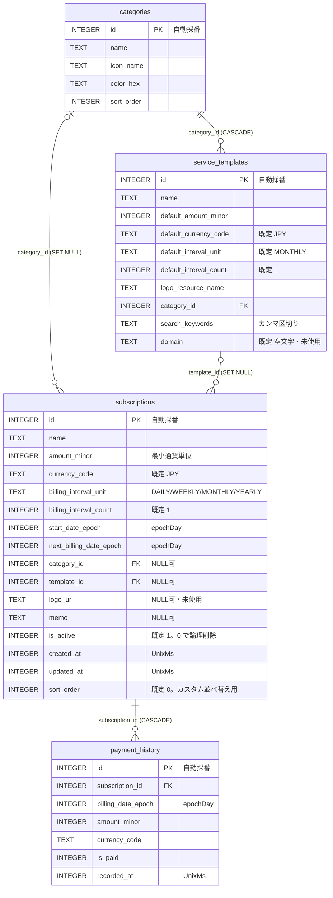
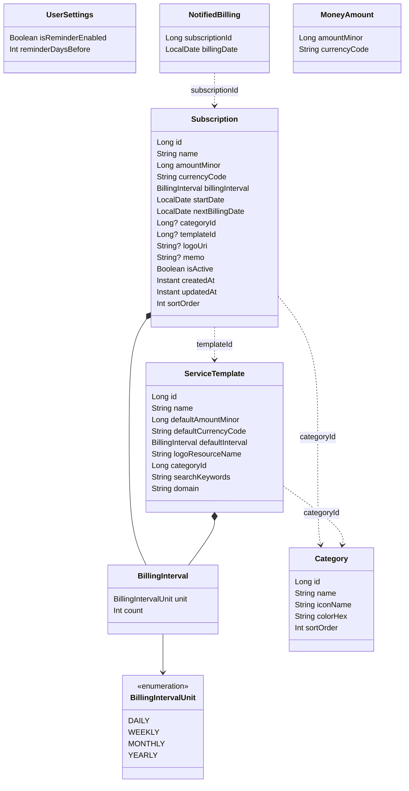
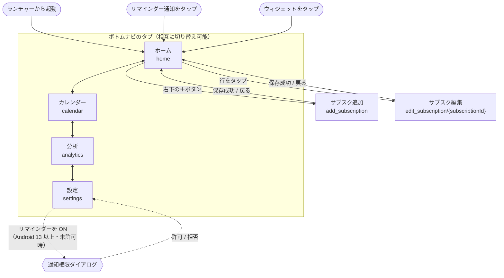
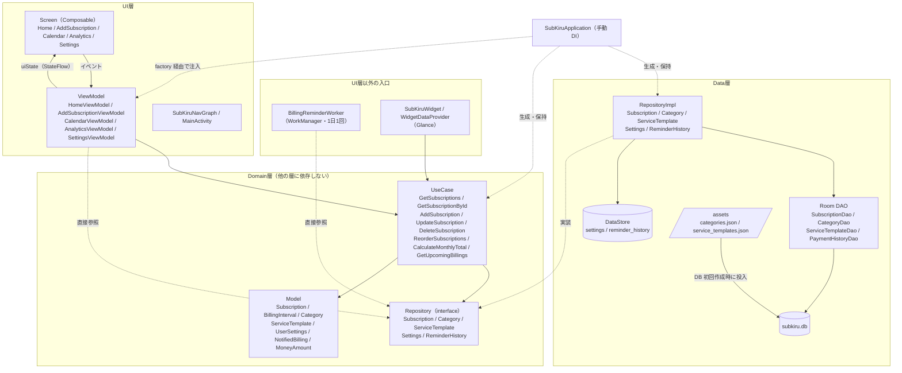
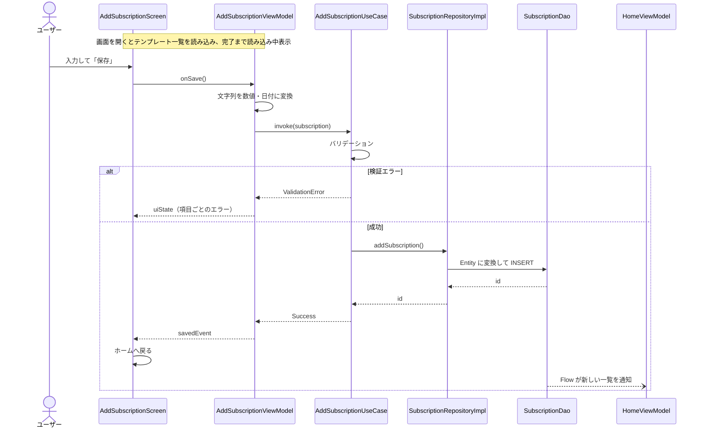

# SubKiru 設計図（DESIGN.md）

最終更新: 2026-10-10 / 対象: DB スキーマ version 3

データモデル・画面遷移・層構成を図で示します。記載内容は現在の実装に基づきます。
機能の仕様は [SPEC.md](SPEC.md)、開発ルールは [AGENTS.md](AGENTS.md) を参照してください。

---

## 1. データモデル

### 1.1 Room（`subkiru.db`）

- 関係線のラベルは「外部キー（親を削除したときの子の挙動）」です。
- `payment_history` は定義のみで、読み書きする処理はありません。
- インデックス: `subscriptions`（`next_billing_date_epoch` / `is_active` / `category_id` / `template_id`）、`service_templates`（`category_id`）、`payment_history`（`subscription_id` / `billing_date_epoch`）。

**マイグレーション履歴**

| version | 変更 |
|---------|------|
| 1 → 2 | `service_templates` に `domain` を追加 |
| 2 → 3 | `subscriptions` に `sort_order` を追加し、既存行に順序を割り当て |

### 1.2 DataStore（Preferences）

| ファイル | キー | 型 | 内容 |
|----------|------|----|------|
| `settings` | `reminder_enabled` | Boolean | 請求日リマインダーの ON/OFF（既定 false） |
| `settings` | `reminder_days_before` | Int | 通知タイミング。1〜7日前（既定 1） |
| `reminder_history` | `notified_billings` | Set&lt;String&gt; | 通知済みの請求。`{サブスクID}:{請求日のepochDay}` 形式 |

### 1.3 ドメインモデルとの対応

Entity とドメインモデルの変換は各 `RepositoryImpl` 内で行います。主な変換は次のとおりです。

| Entity（Room） | ドメインモデル |
|----------------|----------------|
| `billing_interval_unit` + `billing_interval_count` | `BillingInterval` |
| `*_date_epoch`（Long, epochDay） | `LocalDate` |
| `created_at` / `updated_at`（Long, UnixMs） | `Instant` |

---

## 2. 画面遷移

| 画面 | ルート | ボトムナビ | ＋ボタン |
|------|--------|-----------|----------|
| ホーム | `home` | 表示 | 表示 |
| カレンダー | `calendar` | 表示 | 非表示 |
| 分析 | `analytics` | 表示 | 非表示 |
| 設定 | `settings` | 表示 | 非表示 |
| サブスク追加 | `add_subscription` | 非表示 | 非表示 |
| サブスク編集 | `edit_subscription/{subscriptionId}`（Long） | 非表示 | 非表示 |

- 起動時の画面はホームです。通知・ウィジェットからの起動もホームを表示します（特定の画面への直接遷移はありません）。
- 図ではタブ間の矢印を隣同士だけ描いていますが、4つのタブはどれからどれへも直接切り替えられます。タブ切り替えではバックスタックを積まず、各タブの状態を保持します。
- 追加と編集は同じ画面実装（`AddSubscriptionScreen` / `AddSubscriptionViewModel`）を共用します。編集ではテンプレート一覧を表示しません。

---

## 3. 層構成

依存の方向は **UI → Domain ← Data** です。`SubKiruApplication` が Repository と UseCase を生成・保持し、各 ViewModel の `factory` に渡します（手動 DI）。

### 3.1 各入口が使う UseCase / Repository

| 入口 | UseCase | Repository を直接参照 |
|------|---------|----------------------|
| `HomeViewModel` | GetSubscriptions / DeleteSubscription / ReorderSubscriptions | `CategoryRepository` |
| `AddSubscriptionViewModel`（追加・編集） | AddSubscription / UpdateSubscription / GetSubscriptionById | `CategoryRepository` / `ServiceTemplateRepository`（追加時のテンプレート一覧） |
| `CalendarViewModel` | GetSubscriptions | — |
| `AnalyticsViewModel` | GetSubscriptions | — |
| `SettingsViewModel` | — | `SettingsRepository` |
| `BillingReminderWorker` | — | `SettingsRepository` / `SubscriptionRepository` / `ReminderHistoryRepository` |
| `SubKiruWidget` | CalculateMonthlyTotal / GetUpcomingBillings | — |

### 3.2 原則からの逸脱

AGENTS.md は「ViewModel は UseCase のみを呼ぶ」と定めていますが、図の点線「直接参照」のとおり、次の箇所は Repository の interface を直接使っています。いずれも Domain 層の interface への依存であり、DAO や Room には触れていません。

- カテゴリ一覧の取得（`HomeViewModel` / `AddSubscriptionViewModel`）
- テンプレート一覧の取得（`AddSubscriptionViewModel`。追加時のみ）
- 設定の読み書き（`SettingsViewModel`）
- リマインダーの日次チェック（`BillingReminderWorker`）

### 3.3 データの流れ（サブスク追加の例）

Room を唯一の情報源とし、一覧系の画面は DAO の `Flow` を購読しています。書き込みが完了すると、ホーム・カレンダー・分析は自動的に再描画されます。
